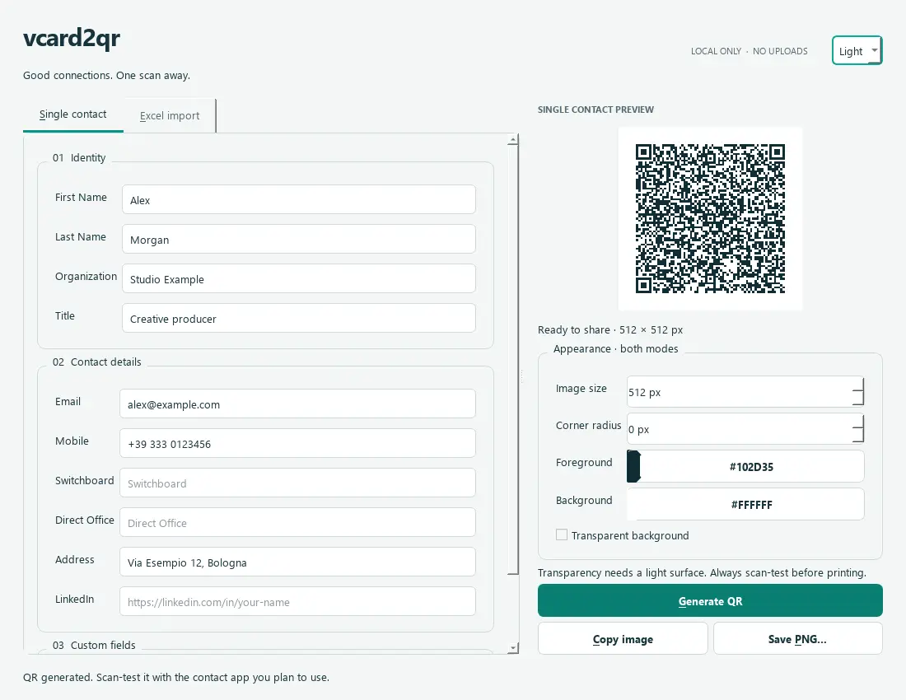

# vcard2qr

Create contact QR codes on your desktop, individually or from an Excel workbook. Your contacts stay on your computer: there are no accounts, uploads, analytics or background services.

Built with Python and **PySide6 / Qt 6**, with light and dark themes, editable Excel column mappings, and PNG export with optional transparency.



## What you can do

- Enter a contact, validate its details, and preview a vCard 3.0 QR code.
- Choose image size, dark foreground, light background and rounded data modules.
- Copy the image with transparency or save it as a PNG.
- Preview an Excel workbook, map columns, and export contacts in the background.
- Cancel an import without losing completed files; inspect the per-row report.

Changing contact details or appearance clears the old preview and disables export until you generate again. Batch conversion never replaces the single-contact preview.

## Install and run

Use **64-bit Python 3.12 or newer**. Local validation was performed on Windows x64 with Python 3.14; the CI workflow also targets Python 3.12. Other operating systems have not been validated for this release.

From the repository folder in PowerShell:

```powershell
# Create an isolated environment and install the pinned runtime.
python -m venv .venv
.\.venv\Scripts\python -m pip install -r requirements.lock
.\.venv\Scripts\python -m pip install --no-deps .

# Start the installed app.
.\.venv\Scripts\python -m vcard2qr
```

The original command `python vcard-2-qr.py` still works with the dependencies installed. `pip install -r requirements.txt` is a convenience installation of the project; use `requirements.lock` when reproducing the full dependency set.

The runtime uses `PySide6-Essentials`, which provides Qt Widgets without unused WebEngine or multimedia components. No standalone Qt installation is required.

### Portable Windows build

Install `requirements-dev.lock`, then run:

```powershell
# Build outside the repository; the complete output folder must travel with the executable.
./scripts/build_windows.ps1 -Python ./.venv/Scripts/python.exe -OutputDirectory "$env:TEMP/vcard2qr-build"
```

Open `dist/vcard2qr/vcard2qr.exe` inside that build folder. Keep its `_internal` directory alongside it. The build is unsigned. The manual **Windows portable build** GitHub Actions workflow creates a downloadable artifact; it does not publish a release automatically.

## Create one contact

1. Fill in the **Single contact** form. Supply a name, organization, email or phone number so the contact has an identity.
2. Add optional custom fields. Use letters A–Z, digits, spaces or hyphens in their names.
3. Choose the appearance. Start with 512 px, square modules and a white background.
4. Click **Generate QR**, or press **Ctrl+Enter**.
5. Scan-test the result, then **Copy image** or **Save PNG**.

Email and URL errors appear beside their fields. URLs must begin with `https://` or `http://`. Images use error correction level Q, one four-module quiet zone and integer-sized modules. The app rejects output sizes below three pixels per module instead of producing a damaged image.

Rounded corners apply conservatively to data modules; finder patterns stay square. Transparency assumes a light final surface. The contrast check is a useful guard, not a guarantee of compatibility with every camera, printer or contact importer.

## Import Excel contacts

1. Choose **Excel import → Choose Excel workbook** and select an `.xlsx` file.
2. Review the active worksheet, first five rows and suggested column mappings.
3. Correct mappings or select **Ignore** for columns you do not need.
4. Choose **Export contacts** and a parent output folder.

Each run creates a new `vcard2qr-<timestamp>-<id>` folder. Files have row-number prefixes, so duplicate names and repeated exports cannot overwrite prior results. `report.jsonl` records one JSON object per processed row, including errors and numeric-phone warnings. Cancellation stops between rows and keeps completed images and the report.

Start with [sample_contacts.xlsx](sample_contacts.xlsx). See [the Excel guide](docs/excel.md) for supported headers, formulas, phone numbers and report examples.

## Development

```powershell
# Add the pinned test and build tools to the isolated environment.
.\.venv\Scripts\python -m pip install -r requirements-dev.lock

# Run from the repository root so tests exercise the current source.
.\.venv\Scripts\python -m ruff check .
.\.venv\Scripts\python -m ruff format --check .
.\.venv\Scripts\python -m pytest -q
.\.venv\Scripts\python -m build --outdir "$env:TEMP/vcard2qr-packages"
```

Tests cover vCard escaping and UTF-8 folding, actual QR decoding using ZXing, transparent PNG export, atomic saving, Excel errors, cancellation, mapping collisions, UI invalidation and worker shutdown. GUI tests use Qt's offscreen platform and do not open desktop windows.

- [Architecture and maintenance](docs/development.md)
- [Validation and release checklist](docs/validation.md)
- [Changes in 2.0](CHANGELOG.md)
- [Third-party notices](THIRD_PARTY_NOTICES.md)

## Troubleshooting

| Message or symptom | What to do |
|---|---|
| Contact needs a larger image | Increase image size or shorten contact/custom fields. |
| Contact exceeds QR capacity | Remove long notes or unnecessary fields; image size does not increase QR data capacity. |
| Invalid email or URL | Correct the indicated field; use a full HTTP(S) URL. |
| Several columns map to the same field | Change the mapping or ignore one column. |
| Formula/error cell rejected | Paste literal values into the workbook before importing. |
| Missing leading zeros in a phone | Store phone cells as text in Excel before entering the number. Existing lost digits cannot be reconstructed. |
| Save fails | Check destination permissions, free space and whether another program has locked the file. |
| Clipboard unavailable | Retry from an interactive desktop session or save the PNG. The app does not report success when Windows denies clipboard access. |
| Qt platform plugin error | Use a clean virtual environment and install the locked dependencies; do not copy an executable without its companion files. |

## Privacy and license status

The app does not send contact data over the network or save the form automatically. PNGs contain the complete encoded contact; copied images enter the system clipboard, whose history/synchronization follows your OS settings. Batch filenames contain contact names and reports contain filenames and validation messages. Treat these exports as contact data.

This repository has **no project license selected**. The modernization does not assign one on the owner's behalf. Third-party packages retain their own licenses; see [THIRD_PARTY_NOTICES.md](THIRD_PARTY_NOTICES.md). License selection and public release remain separate owner decisions.
